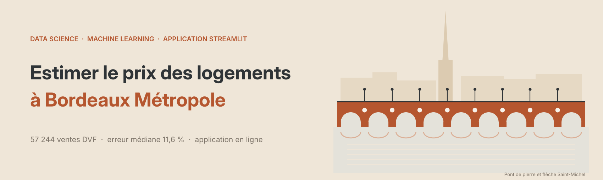
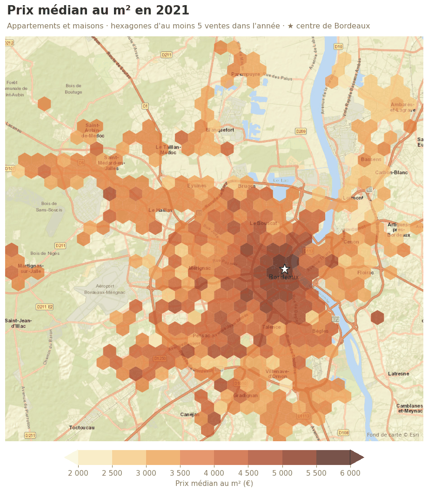
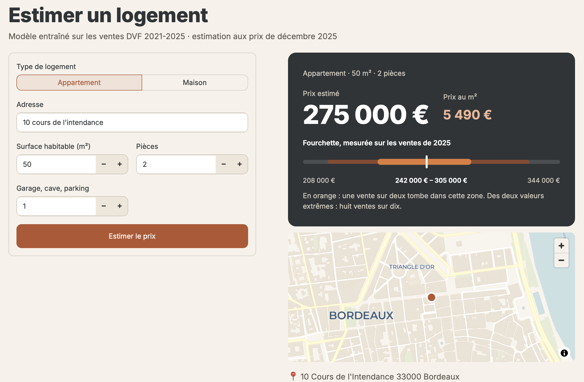

<p align="center">
  
</p>

<p align="center">
  
  
  
  
  
</p>

# Estimer le prix des logements à Bordeaux Métropole

Projet personnel de data science : à partir des ventes immobilières publiques (DVF), un modèle qui estime le prix d'un appartement ou d'une maison dans les 28 communes de Bordeaux Métropole, et une application pour l'utiliser.

**[Tester l'application](LIEN_APPLICATION)** · **[Lire les notebooks](https://nbviewer.org/github/yayefatou-lam/prix-logements-bordeaux/tree/main/notebooks/)**

## Pourquoi ce projet ?

Connaître le prix d'un logement intéresse tout le monde : l'acheteur qui veut savoir s'il paie le juste prix, le vendeur qui fixe son annonce, la banque qui finance l'achat. Depuis 2019, l'État publie toutes les ventes immobilières en données ouvertes (DVF) : le prix, la surface, la position. Mais ces données sont brutes, et pleines de pièges.

Le projet répond à deux questions :
- **Jusqu'où des données publiques permettent-elles d'expliquer et de prédire un prix ?**
- **Où sont leurs limites ?**

Il couvre un cycle complet de data science : du fichier brut à une application que n'importe qui peut utiliser, en passant par le nettoyage, l'exploration, la comparaison de modèles et leur interprétation.

## Résultats en bref

Testé sur les **11 371 ventes de 2025**, une année que le modèle n'a jamais vue :

| Erreur relative médiane | Ventes estimées à ±10 % | Erreur par rapport à la référence |
|:---:|:---:|:---:|
| **11,6 %** | **44 %** | **−23 %** |

Pour un bien estimé à 300 000 €, le prix réel se situe une fois sur deux entre 264 000 et 333 000 €.

| Modèle (test 2025) | Erreur moyenne (€/m²) | Erreur relative médiane | Ventes à ±10 % |
|---|---:|---:|---:|
| Référence : médiane par commune et par type | 818 | 15,9 % | 34,3 % |
| Régression linéaire | 765 | 15,3 % | 34,2 % |
| Plus proches voisins | 712 | 13,5 % | 38,9 % |
| Forêt aléatoire | 637 | 11,7 % | 43,8 % |
| **LightGBM réglé (retenu)** | **630** | **11,6 %** | **44,2 %** |

Ce que les données montrent :
- **Le lieu compte avant tout.** Le prix baisse avec la distance au centre de Bordeaux, et la rive droite est moins chère qu'à distance égale sur la rive gauche. Les appartements valent 2,3 fois plus cher au m² à Bordeaux qu'à Ambès.
- **Le marché a baissé.** Après un pic mi-2022, le prix médian au m² a reculé d'environ 12 % pour les maisons et 9 % pour les appartements jusqu'en 2025.
- **Les maisons sont plus chères au m² que les appartements** dans 27 communes sur 28, probablement parce que leur prix inclut le terrain.



## L'application

- **Estimer un logement :** on saisit une adresse, le type de logement, la surface, le nombre de pièces et, pour une maison, le terrain. L'application donne une estimation, le prix au m² et une fourchette mesurée sur les ventes de 2025. Elle prévient aussi quand le bien est d'un genre rare dans les ventes (une maison de moins de 50 m², par exemple), où l'estimation est moins fiable.
- **Carte des prix :** une carte interactive du prix médian au m² par zone d'environ 800 m, pour tous les logements, les appartements ou les maisons. Seules des médianes de zones d'au moins 10 ventes sont affichées, jamais une vente ou une adresse.

L'application s'utilise aussi sur téléphone.



## Démarche

1. **[Données](notebooks/01_donnees.ipynb) :** dans DVF, une vente s'étale sur plusieurs lignes et son prix est répété sur chacune. On ne garde que les ventes d'un seul logement, puis on applique 8 règles de cohérence (ventes à 1 €, surfaces mal saisies…) : 187 909 ventes au départ, 57 244 à l'arrivée. Chaque décision est expliquée dans [`NETTOYAGE.md`](NETTOYAGE.md).
2. **[Exploration](notebooks/02_exploration.ipynb) :** évolution des prix, écarts entre communes, carte, effet de la surface. Chaque constat oriente le choix des variables.
3. **[Modèles](notebooks/03_modele.ipynb) :** sept modèles comparés, de la régression linéaire au gradient boosting, puis un réglage de LightGBM. Tous les choix sont faits sur 2024 ; le test 2025 n'est utilisé qu'une fois, à la fin.
4. **Interprétation :** avec SHAP, on vérifie ce que le modèle a appris. La distance au centre pèse le plus, et il a retrouvé seul l'effet de la rive droite.
5. **Application :** le script [`src/entrainer.py`](src/entrainer.py) réentraîne le modèle sur toutes les ventes, [`src/carte.py`](src/carte.py) prépare les médianes de la carte, et l'application [Streamlit](app.py) rend le tout utilisable par tous.

## Points de vigilance

- **Des informations absentes :** DVF ne dit rien de l'état du bien, de l'étage, du DPE ni de la vue. Deux logements identiques dans les données peuvent avoir des prix très différents, et une partie de l'erreur est donc impossible à réduire avec ces données.
- **Le temps :** un modèle à arbres ne prolonge pas une tendance. L'estimation est donc donnée aux prix de fin 2025, sans prévision du marché.
- **Une validation honnête :** le découpage se fait dans le temps (apprentissage 2021-2023, validation 2024, test 2025), et non au hasard, pour mesurer l'erreur dans les conditions réelles d'usage.
- **Un essai sans gain :** le prix médian des 20 ventes voisines a été testé comme variable, sans amélioration. L'information était déjà captée par les coordonnées.
- **Des chiffres vérifiés :** le notebook de nettoyage et le script de production, écrits séparément, produisent exactement la même table.

## Reproduire le projet

```bash
git clone https://github.com/yayefatou-lam/prix-logements-bordeaux
cd prix-logements-bordeaux
pip install -r requirements-notebooks.txt

jupyter lab                 # notebooks 01, puis 02 et 03
python -m src.entrainer     # réentraîne le modèle de l'application
python -m src.carte         # prépare les données de la carte (après le notebook 01)
streamlit run app.py        # lance l'application en local
```

Les données sont téléchargées automatiquement depuis data.gouv.fr. Pour intégrer une nouvelle livraison DVF, il suffit de relancer `python -m src.entrainer`. Le fichier `requirements.txt` ne liste que ce dont l'application a besoin pour tourner en ligne.

## Structure

```
├── README.md
├── NETTOYAGE.md         journal des décisions de nettoyage
├── notebooks/           01_donnees, 02_exploration, 03_modele
├── src/                 variables, entraînement, données de la carte, mise en forme
├── app.py               application Streamlit : navigation et éléments communs
├── vues/                pages de l'application (accueil, estimation, carte, à propos)
├── modele/              modèle entraîné, fourchette d'erreur, médianes de la carte
├── assets/              bannière, figures et captures
└── .streamlit/          couleurs et police de l'application
```

## Données

[Demandes de valeurs foncières géolocalisées](https://www.data.gouv.fr/datasets/demandes-de-valeurs-foncieres-geolocalisees), publiées par Etalab à partir des données de la DGFiP (livraison d'avril 2026, ventes 2021 à 2025). Leurs conditions d'utilisation interdisent l'indexation des données par les moteurs de recherche : le dépôt n'en contient donc aucune, elles sont téléchargées à chaque exécution, et aucune adresse n'est affichée.

## Auteure

**Yaye Fatou Lam** · Master 2 Mathématiques appliquées, statistique, Université de Bordeaux · en recherche d'un stage de fin d'études en data à partir de mars 2027

[LinkedIn](https://www.linkedin.com/in/yaye-fatou-lam-258925412) · E-mail : [yayefatou.lam@icloud.com](mailto:yayefatou.lam@icloud.com)